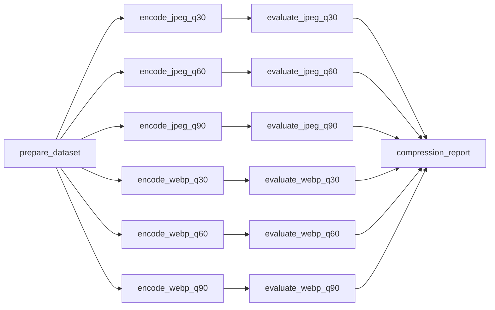

# Image compression with ExpOps

Compare JPEG and WebP on all 24 Kodak reference images. A 14-process workflow prepares the reference manifest, runs six compression branches, evaluates each branch in a separate downstream process, and generates the final report. Encoder quality settings are 30, 60 and 90. Every image has a warm-up and five measured encoding/decoding repetitions. Timings use memory buffers and exclude source downloads, quality scoring and output publication.



Preparation verifies all 24 images against the pinned dataset hashes and passes their dimensions, sizes and identities to every encoder. Each encoder returns a manifest of published S3 image addresses, checksums, encoding timings and library versions. Its evaluator reads those published files through the VFS, checks size/checksum, measures decoding, and compares against the identified reference image. Reports subscribe to the six evaluation processes. Branch evaluations can start as soon as their own encoder finishes.

## Storage and execution

| Role | Cloud resource |
| --- | --- |
| Metadata | Firestore default database in GCP project `exp-ops` |
| Inputs | `gs://exp-ops-image-compression-inputs/kodak/` in `exp-ops` |
| Cache | `s3://expops-test-bucket-755933694771-ap-southeast-1-an/image-compression/cache/` |
| Artefacts | Same S3 bucket under `image-compression/artefact/` |
| Compute | Three local workers or the supplied Slurm profile |

Google Application Default Credentials and the existing AWS `expops` profile supply authentication. Credentials stay outside this repository. Each Slurm worker needs access to the same provider credentials through the platform's existing worker credential configuration. The repository uses the adjacent ExpOps checkout, initially verified at `65db1526cd37dee69480d3068971c10e277989c0`.

## Setup

From this directory on Windows:

```powershell
python -m venv .venv
.venv/Scripts/python.exe -m pip install -e '../expops-platform[gcp,aws,slurm]' -r requirements.txt google-cloud-storage
.venv/Scripts/python.exe scripts/prepare_data.py --upload
powershell -NoProfile -ExecutionPolicy Bypass -File scripts/run.ps1 -Profile cloud
```

The input preparation verifies RGB PNG dimensions and records source URLs, byte counts and SHA-256 hashes in `data/manifest.json`. It creates a private input bucket in `asia-southeast1` if needed. Re-running uploads the same verified local inputs. The 24 PNGs occupy about 15.4 MB. To prepare offline inputs only, omit `--upload`, then use `-Profile local`.

The checked-in `configs/dataset_manifest.json` pins all 24 source hashes. Preparation rejects changed source bytes.

On a prepared Linux Slurm driver:

```bash
python -m pip install -e '../expops-platform[gcp,aws,slurm]' -r requirements.txt
expops run configs/compute.slurm.yaml
```

Adapt account/QOS/queue and worker interpreter/base paths to the cluster. The code mount points at this checkout and uses ExpOps source preparation. The Slurm profile requires provider access from the worker nodes and should be rehearsed on the target cluster.

## Tangible outputs

The static report publishes 24 labelled before/after PNG panels, a size-quality-time overview, codec timing chart, CSV and JSON measurements. Panels show the reference alongside JPEG and WebP at each setting for images 01, 05, 13 and 23. Full-image panels scale to fit. Detail panels enlarge a fixed centre crop with nearest-neighbour scaling so interpolation does not hide codec artefacts. Compressed files are retained as intermediate inputs for evaluation and comparison rendering.

Additional quality outputs bring the report total to 37 artefacts:

| Output | What it shows |
| --- | --- |
| `image_quality_comparison.png` | Mean SSIM and PSNR versus encoder setting, with +/- one sample standard deviation across the 24 photographs |
| `per_image_ssim.png` | All 144 SSIM values in a labelled image-by-configuration heatmap |
| `quality_distribution.png` | Per-configuration SSIM distributions across the photographs, with medians, quartiles, means and outliers |
| `quality_vs_storage_savings.png` | Mean SSIM versus mean percentage file-size reduction from the reference PNG |
| `pixel_differences_kodim*.png` | Reference and JPEG/WebP Q30 mean absolute RGB pixel-error maps for the four selected photographs |
| `quality_summary.csv` | Configuration means and sample standard deviations for SSIM, PSNR, bits per pixel and percentage size reduction |

Difference maps use the same colour scale for JPEG and WebP, saturating at an absolute RGB error of 64 out of 255. Numerical differences show altered pixels. Before/after samples show the resulting appearance. Standard deviations describe variation across photographs. Percentage savings use each photograph's reference PNG byte size as the baseline and weight all 24 images equally. Codec-specific settings and the size-quality curves should be interpreted together.

The report verifies S3 output checksums before rendering and publishing its managed outputs. Intermediate encodings are content-addressed under the artefact mount and reused by reporting. The platform retains benchmark outputs in its S3 process cache and replays their metrics on cached runs.

To retrieve an overview, sample comparison panels and measurements independently of execution, use the run ID printed by ExpOps:

```powershell
.venv/Scripts/python.exe scripts/fetch_report.py <run-id>
```

Add `--all` to retrieve all published artefacts. This uses the read-only metadata API and verifies each published file's size and checksum. Downloads appear under `output/<run-id>/`.

Numerical metrics are SSIM and PSNR on RGB arrays with a fixed range of 255, file bytes, bits per pixel, percentage size reduction from the reference PNG, and median encode/decode milliseconds. Quality numbers belong to each encoder. Compare the measured size-quality curves and visual samples. SSIM is an objective similarity metric, and the display panels provide qualitative examples of visual quality. Compression relative to the reference PNG measures the supplied file representation.

Preparation logs image-validation progress. Compression processes log image counts, sizes and encoding timings. Evaluation processes log image counts, decoding timings and reconstruction metrics. Connect the independent Run Monitor to the Firestore metadata and the configured mounts. A repeated identical command exercises cache reuse. Actual queue, startup and transfer time depend on the execution environment.

After preparing the local dataset, run the stage-contract tests with `.venv/Scripts/python.exe -m unittest discover -s tests -v`. These check the 14-process topology, JPEG/WebP file handoffs, intermediate corruption detection and reference identity verification.

## Dataset credit

Kodak Lossless True Color Image Suite, hosted and converted to PNG by Rich Franzen, https://r0k.us/graphics/kodak/. Photographer credits are linked from that site. Keep this acknowledgement with demonstrations and redistributed samples.

Dependencies and encoder versions are recorded with each report. Local dataset copies, generated results, credentials and environments are ignored by Git.

## Verified execution

On 15 November 2026, the 14-process workflow ran with three local CPU workers and live Firestore, GCS and S3 storage. Run `project-image-compression-20261115122251-8b66c47a` completed all 14 processes and published 172 indexed artefacts. Runtime after environment preparation was 227 seconds, including input identity checks, computation and output publication. Evaluation began while other branches were still encoding. All 144 encoded-file hashes, sizes, PSNR values and SSIM values matched the earlier seven-process implementation. Each row retained five encoding and five decoding timing samples. The comparison panel was visually inspected after checksum-verified retrieval.

The unchanged rerun `project-image-compression-20261115122640-0e8ff504` reused all 14 processes and completed in 19 seconds after environment preparation. Four focused stage-contract tests passed. The supplied Slurm configuration awaits execution on the target cluster.

The expanded quality report was verified in run `project-image-compression-20261115151642-0369f345` on 15 November 2026. All 14 processes completed in 227 seconds after environment preparation with 181 indexed artefacts. All 144 image hashes and PSNR/SSIM scores matched the earlier workflow. Percentage savings and all six configuration summaries were independently checked, five focused tests passed, and the new chart/difference-map downloads were checksum-verified through the running ExpOps server. The chart layouts were visually inspected.

On 16 November 2026, run `project-image-compression-20261115164322-308a3565` verified the comparison-focused report. All 14 processes completed in 167 seconds after preparation, publishing 37 outputs with all 144 measurement rows. Six focused tests passed, including a full report-output check. The completed Slurm run's gallery was also updated to show these output categories. The revised reporting source was uploaded to the Slurm deployment.
